

  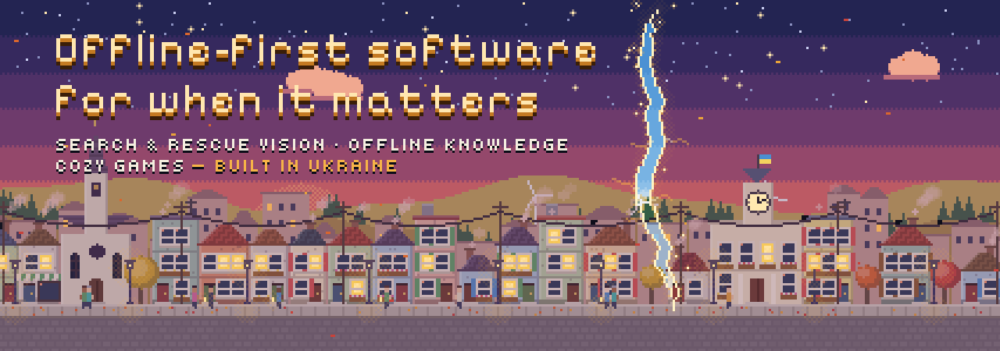

I build small, open tools that keep working when the network does not: vision for search-and-rescue drones on a $15 computer, answers from your own documents with no internet, learning for children in Ukraine, and a cozy game about a little Ukrainian town.

<b>Available for MVPs and product work</b> · <a href="#need-an-mvp-or-a-product-built">what I build</a> · <a href="CASES.md">case studies</a> · <a href="mailto:sasha.piscivca@gmail.com">sasha.piscivca@gmail.com</a>

### Projects

  <a href="https://github.com/sashapiscivca-svg/teul">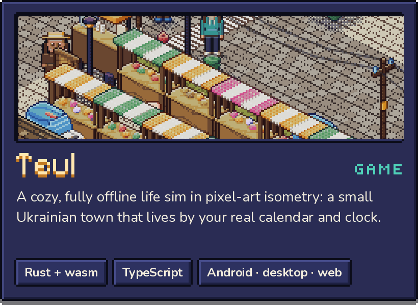</a>
  <a href="https://github.com/sashapiscivca-svg/hae">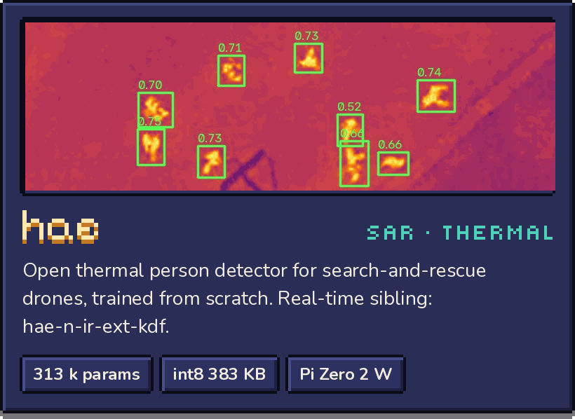</a>
  <a href="https://github.com/sashapiscivca-svg/dal">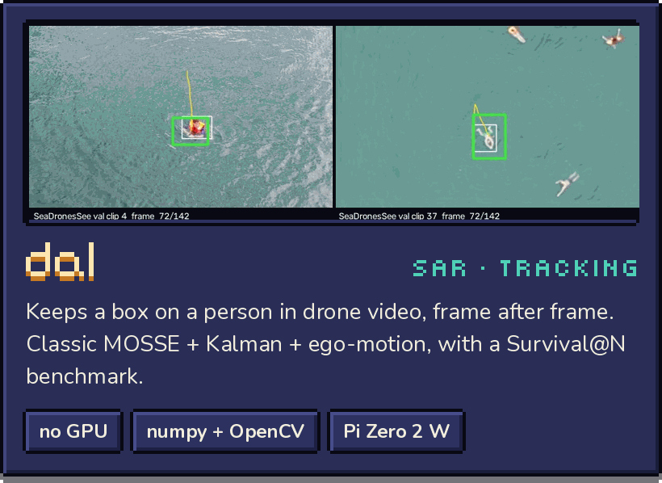</a>
  <a href="https://github.com/sashapiscivca-svg/byeol">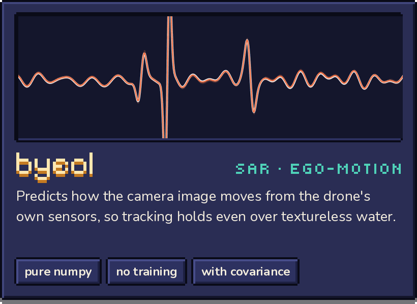</a>
  <a href="https://github.com/sashapiscivca-svg/Kovcheg">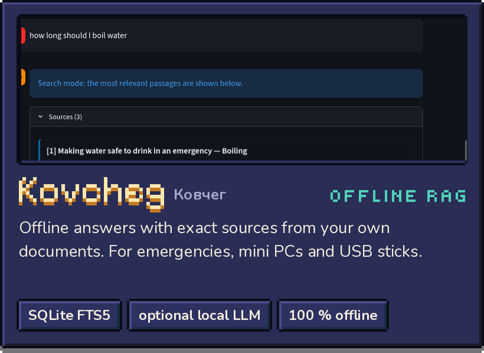</a>
  <a href="https://github.com/sashapiscivca-svg/kmit-public">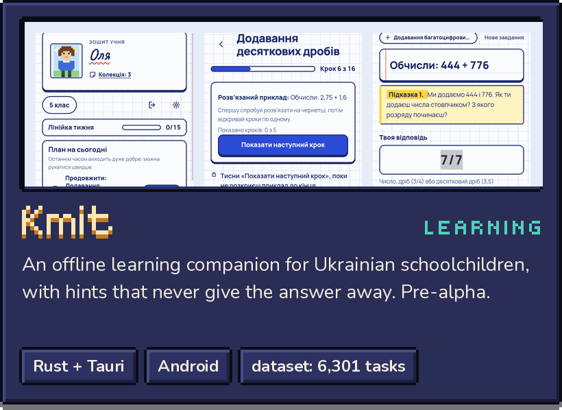</a>

Also: <a href="https://github.com/sashapiscivca-svg/hae-n-ir-ext-kdf"><b>hae-n-ir-ext-kdf</b></a>, a 54 k-parameter real-time companion to hae for forest and wilderness footage · <a href="https://huggingface.co/datasets/alexshynkarenk0/kmit-math-5"><b>Kmit Math 5</b></a>, 6,301 Ukrainian grade-5 maths tasks with verified answers and hints (CC BY 4.0)

### Try it in your browser

  <a href="https://sashapiscivca-svg.github.io/teul/">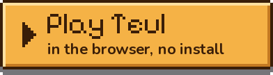</a>
  <a href="https://huggingface.co/spaces/alexshynkarenk0/hae-demo">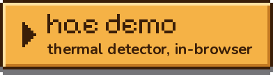</a>
  <a href="https://huggingface.co/spaces/alexshynkarenk0/kovcheg-demo">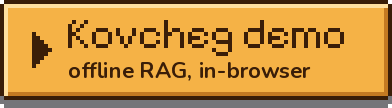</a>
  <a href="https://huggingface.co/alexshynkarenk0">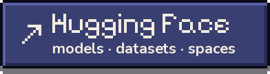</a>

### Principles

- **Offline-first and private.** No accounts, no servers, no tracking: your data stays on your device.
- **Civilian use only.** The search-and-rescue tools exist to find people in danger. They are not for military use.
- **Honest numbers.** Open code and weights, reproducible evaluations, and the limitations written down first.

### Tools

Rust · TypeScript · Python · PyTorch → ONNX · WebAssembly · numpy · OpenCV · SQLite · Tauri · Capacitor

### Need an MVP or a product built?

I take on projects for clients in Ukraine and abroad: from an idea to a working first version, or a finished product.

- **Apps that work offline:** Android, desktop and web from one codebase, with data that stays on the device.
- **AI on cheap hardware:** computer vision and small models running on a Raspberry Pi or a phone, without a cloud.
- **Search over your own documents:** answers with exact sources, on a laptop or a mini PC, with no internet.
- **Games and interactive learning:** browser and mobile, pixel art included.

You get the source code, tests and documentation in English or Ukrainian. Civilian projects only. How past projects went: **[case studies](CASES.md)**.

📫 **[sasha.piscivca@gmail.com](mailto:sasha.piscivca@gmail.com)**: tell me what you want to build, for whom and by when. For security issues in my repositories, please use their private vulnerability reporting.

### Українською

Роблю відкриті програми, які працюють без інтернету, коли це справді важливо: зір для пошуково-рятувальних дронів, відповіді з власних документів офлайн, навчання для дітей в Україні й затишну гру про містечко Липове. Лише цивільне застосування.

**Беру замовлення** від українців та іноземців: MVP або готовий продукт — офлайн-застосунки (Android, комп'ютер, веб), ШІ на дешевому залізі, пошук по власних документах, ігри й навчальні програми. Ви отримуєте вихідний код, тести й документацію. Лише цивільні проєкти. Як ішли попередні проєкти — **[кейси](CASES.uk.md)**.

Пишіть на **[sasha.piscivca@gmail.com](mailto:sasha.piscivca@gmail.com)**: що хочете зробити, для кого й до якого терміну.

The banner and the Teul pictures are Teul artwork © the Teul authors, [CC BY-NC-ND 4.0](https://creativecommons.org/licenses/by-nc-nd/4.0/). Fonts: Pixelify Sans, Tiny5, Nunito (SIL OFL 1.1). All images are drawn by [`scripts/make_assets.py`](scripts/make_assets.py).
